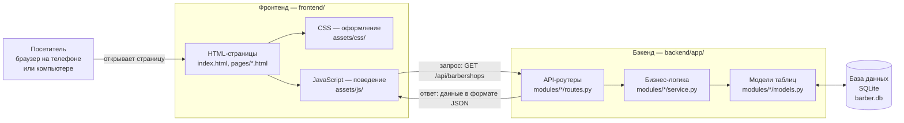

# Общая схема: как всё связано

## Аналогия с рестораном

Проще всего представить сайт как ресторан:

| В ресторане | В проекте | Где в папках |
|---|---|---|
| **Зал**: столы, меню, интерьер — то, что видит гость | **Фронтенд** — страницы в браузере | `frontend/` |
| **Официант**: принимает заказ и приносит блюдо | **API** — «окошко», через которое браузер общается с сервером | адреса `/api/...` |
| **Кухня**: готовит, проверяет, считает | **Бэкенд** — сервер на Python (FastAPI) | `backend/app/` |
| **Склад**: где хранятся продукты | **База данных** SQLite | файл `backend/data/barber.db` |
| **Правила кухни**: нельзя подать блюдо, которого нет | **Бизнес-логика**: нельзя записаться на занятое время | `backend/app/modules/` |

Гость (браузер) **никогда не заходит на склад сам**. Он просит официанта (API),
кухня (сервер) проверяет запрос и берёт со склада (базы) только то, что положено.

## Схема

## Один сервер на всё

Сервер FastAPI делает две работы одновременно:

1. **Раздаёт файлы сайта** — HTML, CSS, JavaScript, картинки (как обычный файловый сервер).
2. **Отвечает на запросы API** — всё, что начинается с `/api/`.

Поэтому для работы сайта достаточно запустить **одну программу** — это удобно и для показа,
и для размещения в интернете.

## Почему страница сначала пустая, а потом наполняется

HTML-страница приходит «каркасом» — заголовки, места под карточки. Потом JavaScript на странице
спрашивает у сервера данные (например, список барбершопов) и сам рисует карточки.
Пока данные идут — показываются серые «скелетоны» (мерцающие заглушки).

Так сделано, чтобы:
- данные всегда были **свежими** (например, свободное время меняется каждую минуту);
- одна и та же страница `barbershop.html` показывала **любой** барбершоп — по номеру в адресе
  (`barbershop.html?id=1`, `?id=2` и т.д.), а не делать отдельный файл на каждый.

## Как хранится вход в аккаунт

1. Пользователь вводит email и пароль → сервер проверяет пароль.
2. Сервер выдаёт **токен** — длинную случайную строку, «пропуск».
3. Браузер сохраняет токен у себя (в `localStorage`) и прикладывает его к каждому запросу.
4. Сервер по токену понимает, кто это, и показывает только **его** записи и заказы.

Подробнее — [05-сервер-бэкенд/05-безопасность.md](../05-сервер-бэкенд/05-безопасность.md).
