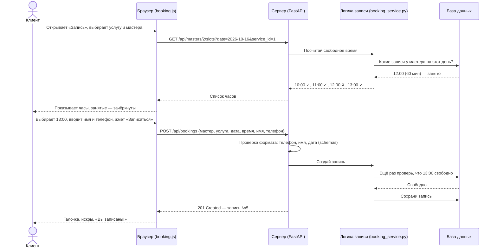

# Путь одного клика: что происходит при записи на стрижку

Разберём по шагам самый важный сценарий — клиент нажимает «Записаться».

## Шаг за шагом



## Почему время проверяется два раза

Пока клиент заполнял имя и телефон, кто-то другой мог успеть записаться на то же время.
Поэтому сервер **перед сохранением проверяет ещё раз**. Если время уже занято — вернёт ошибку
«Это время уже занято, выберите другое», а сайт вернёт клиента на шаг выбора времени.

Это и есть **защита от двойной записи** — одна из главных функций проекта.

## Что именно проверяет сервер

| Проверка | Что будет, если не пройдена |
|---|---|
| Имя от 2 символов, телефон 10–12 цифр | Ошибка «Введите корректный номер телефона» |
| Барбершоп, мастер и услуга существуют | «Барбершоп, мастер или услуга не найдены» |
| Мастер работает именно в этом барбершопе | «Мастер не работает в этом барбершопе» |
| Дата не в прошлом и не дальше 30 дней | «Запись доступна на ближайшие 30 дней» |
| Время — из сетки (каждый час), услуга помещается до закрытия | «Выбрано недопустимое время» |
| Время не пересекается с другими записями мастера | «Это время уже занято, выберите другое» |
| Если запись на сегодня — не раньше, чем через 15 минут | Время показывается занятым |

## Как это выглядит «в цифрах»

Запрос браузера — это короткий текст в формате **JSON** (читается почти как обычный текст):

```json
{
  "barbershop_id": 1,
  "master_id": 2,
  "service_id": 1,
  "date": "2026-10-16",
  "time": "13:00",
  "client_name": "Иван",
  "client_phone": "+7 701 555 44 33"
}
```

Ответ сервера:

```json
{
  "id": 5,
  "barbershop": "The Cut",
  "master": "Данияр",
  "service": "Стрижка",
  "date": "2026-10-16",
  "time": "13:00",
  "price": 12000,
  "status": "new"
}
```

Обратите внимание: **цену клиент не присылает** — сервер берёт её из базы.
Так нельзя «подделать» цену через браузер.
