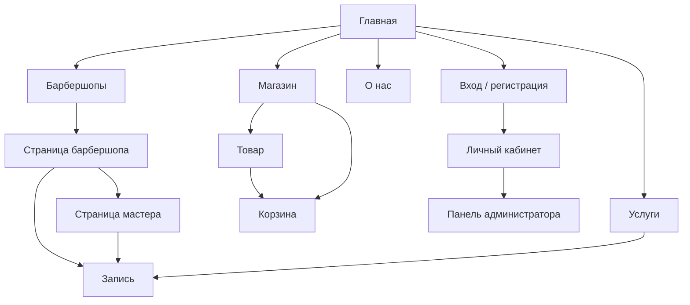

# Все страницы сайта

У каждой страницы есть два файла: **HTML** (каркас) в `frontend/` или `frontend/pages/`
и **скрипт** в `frontend/assets/js/pages/`, который наполняет её данными.

## Карта сайта

## Подробно по страницам

### 1. Главная — `index.html` + `home.js`
- **Главный экран** собран из слоёв: фон-интерьер, огромное контурное слово STYLE, фото мужчины в кресле,
  дымка. Слои двигаются с разной скоростью за мышью и при прокрутке — эффект глубины (параллакс).
- Поиск: выбрать город и услугу → переход в каталог барбершопов с этими фильтрами.
- Цифры: сколько барбершопов и мастеров (берутся с сервера, «отсчитываются» анимацией).
- Бегущая строка с услугами под наклоном.
- «Как это работает» — три шага лесенкой с огромными контурными цифрами.
- Популярные барбершопы — крупная карточка + две маленьких («бенто»).
- Услуги — карточки со смещением по высоте.
- Промо магазина — флакон «выходит» за рамку блока.
- Блок «О нас» — карточка с текстом наезжает на фото.
- Подписка на новости по email.

### 2. Барбершопы — `pages/barbershops.html` + `barbershops.js`
- Выбор города, поиск по названию и адресу (ищет по мере набора, с небольшой задержкой).
- Фильтры: **Все**, **Рядом со мной** (геолокация браузера → сортировка по расстоянию в км),
  **Рейтинг**, **Открыто сейчас** (по часам работы), **Избранное** (только для вошедших).
- Сердечко «в избранное» на каждой карточке.
- Фильтры запоминаются в адресе страницы — ссылкой можно поделиться.

### 3. Страница барбершопа — `pages/barbershop.html?id=1` + `barbershop.js`
- Большая обложка, рейтинг, адрес, часы работы, кнопки «назад», «в избранное», «поделиться».
- Вкладки: **Обзор** (галерея — фото открываются на весь экран), **Услуги** (цены и длительность),
  **Мастера**, **Отзывы** (вошедший пользователь может оставить отзыв), **Контакты** (ссылка на 2ГИС).
- Справа — **быстрая запись**: услуга, мастер, полоса из 7 дней, свободные часы → «Продолжить».

### 4. Мастер — `pages/master.html?id=1` + `master.js`
- Портрет, должность, стаж, рейтинг, специализация, «о мастере», работы (портфолио), отзывы.
- Кнопка «Записаться к мастеру» — сразу открывает запись с этим мастером.

### 5. Услуги — `pages/services.html` + `services.js`
- Карточки 8 услуг и прайс-лист с ценами и длительностью. Нажатие ведёт в запись.

### 6. Запись — `pages/booking.html` + `booking.js`
Мастер записи из 4 шагов, справа всегда видна сводка «Ваша запись» и итоговая цена:
1. **Услуга** — выбор барбершопа и услуги;
2. **Мастер** — карточки мастеров барбершопа;
3. **Дата и время** — календарь на месяц (доступны 30 дней вперёд) и свободные часы;
4. **Подтверждение** — имя, телефон, комментарий.

Если на страницу пришли со страницы барбершопа или мастера, уже выбранные шаги пропускаются.
После записи — экран «Вы записаны!» с номером записи.

### 7. Магазин — `pages/shop.html` + `shop.js`
- Категории слева (на телефоне — прокручиваемая строка), поиск, сортировка.
- Кнопка корзины на каждом товаре: товар «летит» в иконку корзины в шапке.

### 8. Товар — `pages/product.html?id=3` + `product.js`
- Фото, бренд и объём, цена, рейтинг, количество, «Добавить в корзину».
- Вкладки: описание, применение, доставка. Блок «С этим покупают» (товары той же категории).

### 9. Корзина — `pages/cart.html` + `cart.js`
- Изменение количества, удаление, итог.
- Оформление: имя, телефон, **самовывоз** (бесплатно) или **курьер** (1 500 ₸, от 30 000 ₸ бесплатно),
  адрес, комментарий. Оплата при получении.
- Корзина хранится в браузере, поэтому не пропадает при перезагрузке страницы.

### 10. О нас — `pages/about.html` + `about.js`
- Многослойный главный экран (портрет мастера), история, цифры, ценности,
  все барбершопы с адресами (раздел «Контакты»), подписка.

### 11. Вход — `pages/login.html` + `login.js`
- Две вкладки: «Вход» и «Регистрация». После входа возвращает туда, откуда пришли.
- Внизу подсказка с демо-аккаунтами.

### 12. Личный кабинет — `pages/account.html` + `account.js`
- Профиль (можно изменить имя и телефон), выход.
- Вкладки: **Мои записи** (отмена будущих записей, «Повторить» для выполненных),
  **Заказы**, **Избранное**.

### 13. Панель администратора — `pages/admin.html` + `admin.js`
- Доступна только администратору (проверяет сервер, а не только страница).
- 6 карточек сводки, таблица записей с фильтрами по дате и статусу, таблица заказов.
- Статус меняется выпадающим списком прямо в таблице.

### 14. Страница 404 — `404.html`
- Показывается, если открыть несуществующий адрес.

## Общие части на всех страницах

Шапка (логотип, меню, поиск, корзина со счётчиком, вход, «Записаться»), мобильное меню,
подвал, живой фон, анимации — рисуются одним общим скриптом `components/layout.js`.
Поэтому меню меняется в **одном** месте, а не в 14 файлах.
