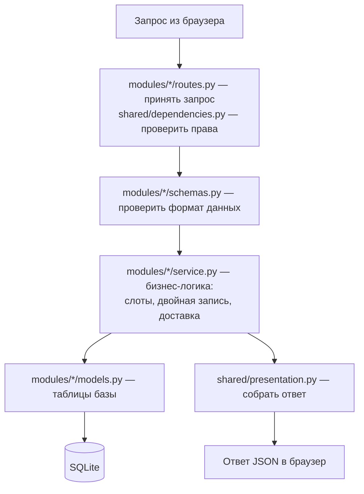

# Что делает сервер (бэкенд)

Сервер — это программа на языке **Python**, которая постоянно работает и ждёт запросов от браузера.
Она написана с помощью **FastAPI** — популярного современного фреймворка (набора готовых инструментов)
для создания API.

## Главные обязанности сервера

1. **Хранить данные** — барбершопы, мастеров, записи, заказы, пользователей (в базе SQLite).
2. **Проверять всё, что приходит** — формат телефона, существование мастера, права доступа.
3. **Принимать решения** — какое время свободно, сколько стоит заказ, можно ли отменить запись.
4. **Отдавать данные** браузеру в формате JSON.
5. **Раздавать файлы сайта** — HTML, CSS, JS, картинки.

## Как сервер запускается (`backend/app/main.py`)

При старте сервер:
1. читает настройки из `backend/.env` (`core/config.py`);
2. подключается к базе данных и **создаёт таблицы**, если их ещё нет;
3. если база пустая — **заполняет её демо-данными** (`seed/`);
4. подключает все адреса API (`modules/`);
5. начинает раздавать папку `frontend/` как сайт.

Запускает его программа **Uvicorn** — веб-сервер, который «слушает» порт 8000.

## Используемые библиотеки (`requirements.txt`)

| Библиотека | Зачем |
|---|---|
| **FastAPI** | Создание API: адреса, обработка запросов, автоматическая документация `/docs` |
| **Uvicorn** | Запускает FastAPI-приложение как веб-сервер |
| **SQLAlchemy** | Работа с базой данных через Python-классы, без ручного SQL |
| **Pydantic** | Проверка входящих данных (телефон, email, длина текста) |
| pytest, httpx | Только для автотестов |

Пароли шифруются стандартной библиотекой Python (`hashlib`), без сторонних пакетов.

## Автоматическая документация API

FastAPI сам создаёт интерактивную страницу со всеми адресами: **http://localhost:8000/docs**.
Там можно раскрыть любой адрес, нажать «Try it out» и отправить запрос прямо из браузера.
Это удобно показывать комиссии.

## Устройство предметного модуля

Маршруты, схемы, модели и правила операции находятся внутри своей предметной области.
Например, `modules/booking/routes.py` вызывает расчёт времени из соседнего `service.py`.
Проверка прав и представления ответов вынесены в общий `shared/`.
