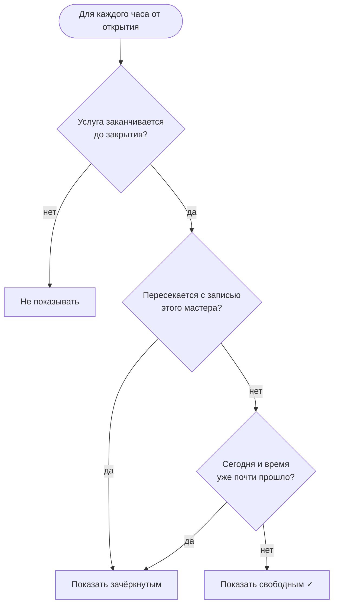
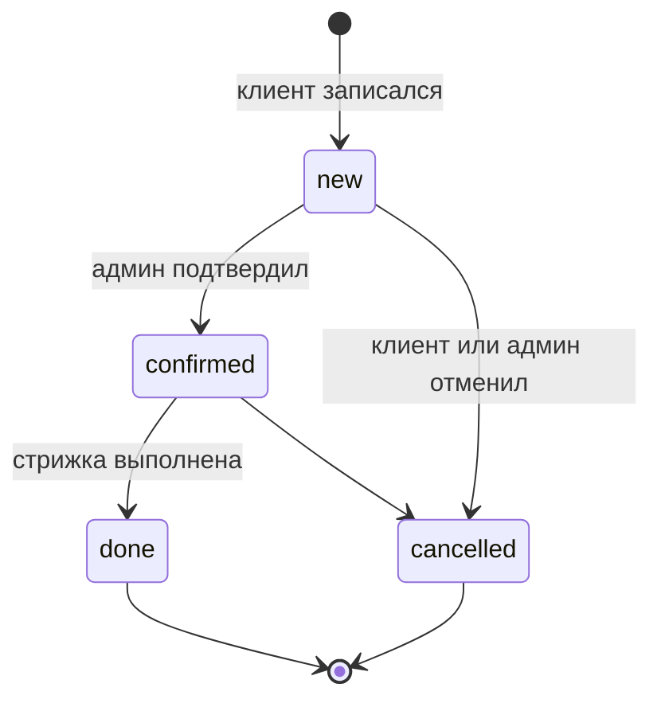

# Логика онлайн-записи (самое важное)

Файл: `backend/app/modules/booking/service.py`

## Настройки

| Параметр | Значение | Смысл |
|---|---|---|
| `SLOT_STEP` | 60 минут | Записи начинаются в начале каждого часа: 10:00, 11:00… |
| `BOOKING_HORIZON` | 30 дней | Записаться можно максимум на месяц вперёд |
| `MIN_LEAD_MINUTES` | 15 минут | На сегодня — не раньше, чем через 15 минут от текущего времени |
| Активные статусы | «новая», «подтверждена» | Только они занимают время. Отменённые и выполненные — нет |

## Как считается свободное время

Пример: мастер Данияр, барбершоп работает **10:00–22:00**, у мастера уже есть запись **12:00–13:00**.
Клиент выбирает «Стрижку + бороду» — она длится **90 минут**.

Сервер перебирает часы от открытия до закрытия и для каждого проверяет три условия:

1. **Услуга успевает до закрытия.** 21:00 + 90 мин = 22:30 > 22:00 → 21:00 вообще не показывается.
2. **Нет пересечения с другими записями.** 11:00 + 90 мин = 12:30 — залезает на запись 12:00 → недоступно.
   Правило пересечения: новая запись должна **закончиться до** начала чужой или **начаться после** её конца.
3. **Время не прошло** (только для сегодняшнего дня, с запасом 15 минут).

Результат: `10:00 ✓, 11:00 ✗, 12:00 ✗, 13:00 ✓, … 20:00 ✓` (21:00 в списке нет — услуга не успеет до закрытия).

## Защита от двойной записи

Когда клиент нажимает «Записаться», сервер **заново** рассчитывает слоты и проверяет, что выбранное время
всё ещё свободно. Если за эти секунды его занял кто-то другой — запись **не создаётся**,
сервер отвечает кодом 409 «Это время уже занято», а сайт возвращает клиента к выбору времени.

Перед проверкой сервер блокирует изменение расписания выбранного мастера до завершения операции. Это защищает и пересекающиеся услуги с разными часами начала; уникальный индекс дополнительно запрещает одинаковое начало активных записей. Проверено тестами обычной и параллельной записи.

Если администратор восстанавливает отменённую запись, вся её продолжительность проверяется снова. Занятое или недоступное время даёт ошибку 409, а статус остаётся прежним.

## Цена записи

Цена и длительность **копируются из услуги в момент записи**. Если потом барбершоп поднимет цены,
у старых записей останется та цена, по которой клиент записывался.

## Отмена

Клиент может отменить **только свою** запись и только если она ещё «новая» или «подтверждена».
После отмены время у мастера снова становится свободным (проверено тестом).

## Статусы записи

| Статус | На сайте |
|---|---|
| `new` | Новая |
| `confirmed` | Подтверждена |
| `done` | Выполнена |
| `cancelled` | Отменена |
