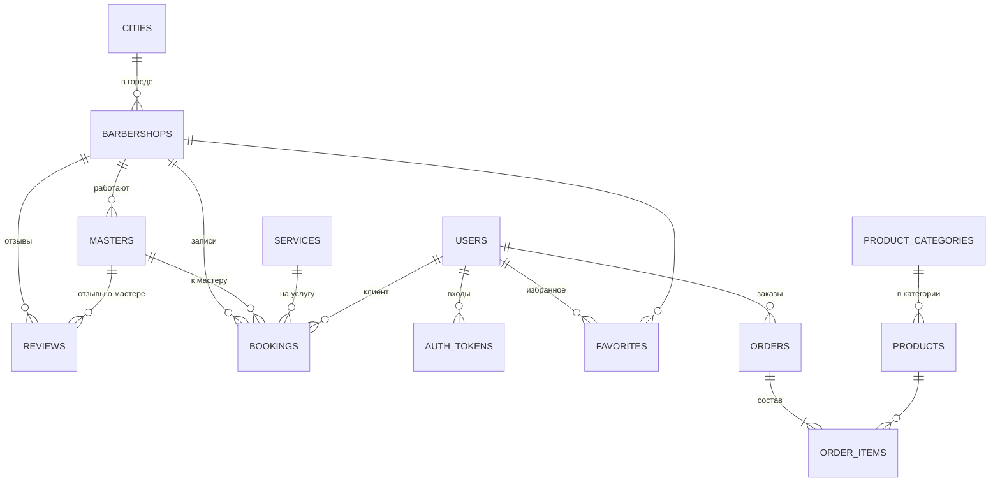

# База данных: таблицы и связи

## Что это

**База данных** — это файл `backend/data/barber.db`, в котором информация хранится в виде **таблиц**,
как в Excel: у таблицы есть колонки (поля) и строки (записи).

Используется **SQLite** — база данных в одном файле, не требует установки отдельной программы.
Для дипломного проекта и небольшого сайта этого достаточно. При росте можно перейти на PostgreSQL,
поменяв одну строку настроек (`DATABASE_URL`) — код менять не нужно, потому что работа с базой
идёт через библиотеку **SQLAlchemy**.

Описание таблиц в коде: `backend/app/models/`.

## Схема связей

Как читать: `CITIES ||--o{ BARBERSHOPS` — «в одном городе может быть много барбершопов,
а каждый барбершоп — ровно в одном городе».

## Все 14 таблиц

### Пользователи

| Таблица | Что хранит | Главные поля |
|---|---|---|
| `users` | Пользователи | имя, email (уникальный), телефон, **хэш пароля**, признак админа, дата регистрации |
| `auth_tokens` | Активные входы | токен, чей он, когда выдан |
| `favorites` | Избранные барбершопы | пользователь + барбершоп (пара уникальна — нельзя добавить дважды) |
| `subscribers` | Подписчики новостей | email, дата |

### Каталог

| Таблица | Что хранит | Главные поля |
|---|---|---|
| `cities` | Города | название, slug (`almaty`) |
| `barbershops` | Барбершопы | название, город, адрес, телефон, часы работы, описание, **координаты** (для «Рядом со мной»), рейтинг, число отзывов, фото |
| `services` | Услуги | название, описание, **цена**, **длительность в минутах**, фото |
| `masters` | Мастера | барбершоп, имя, должность, стаж, о себе, специализации, фото, работы, рейтинг |
| `reviews` | Отзывы | барбершоп, мастер (необязательно), автор, оценка 1–5, текст, дата |

### Запись

| Таблица | Что хранит | Главные поля |
|---|---|---|
| `bookings` | Записи | барбершоп, мастер, услуга, **дата**, **время**, длительность, цена, имя и телефон клиента, комментарий, **статус**, пользователь (если был вход) |

### Магазин

| Таблица | Что хранит | Главные поля |
|---|---|---|
| `product_categories` | Категории | название, порядок |
| `products` | Товары | категория, название, бренд, объём, цена, описания, фото, метка («Хит»), рейтинг, **остаток на складе** |
| `orders` | Заказы | клиент, телефон, доставка, адрес, **стоимость доставки**, **итог**, статус |
| `order_items` | Состав заказа | заказ, товар, **название и цена на момент покупки**, количество |

## Почему некоторые данные «дублируются»

- В записи хранится **цена и длительность** услуги, а в составе заказа — **название и цена** товара.
  Это сделано специально: если потом цена изменится, в истории останется та, по которой покупали.
  Так работают все настоящие магазины и чеки.
- У барбершопа хранится готовый **рейтинг и число отзывов**, а не считается каждый раз заново —
  так список барбершопов загружается быстрее. При новом отзыве рейтинг пересчитывается.

## Slug — что это

`slug` — короткое имя латиницей для адресов: «Алматы» → `almaty`, «Blind Barber» → `blind-barber`.
По нему удобно фильтровать (`/api/barbershops?city=almaty`) и называть файлы фото (`shops/blind-barber-1.jpg`).
