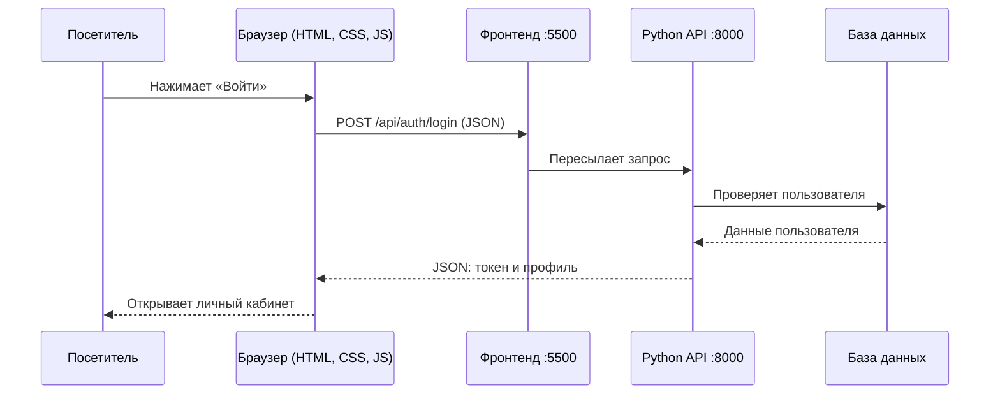

# HTML, CSS, JavaScript и Python в Blind Barber

Это руководство объясняет технологии на примерах именно этого проекта. Его можно использовать для изучения кода, доработок и подготовки к защите. Примеры, обозначенные как учебные, сокращены и не заменяют рабочие файлы.

## Порядок чтения

| Глава | Что вы узнаете |
|---|---|
| [01 — HTML](01-html.md) | Из чего состоит страница, как устроены теги, формы и подключение файлов |
| [02 — CSS](02-css.md) | Как заданы цвета, размеры, сетки, состояния кнопок и адаптация под телефон |
| [03 — JavaScript](03-javascript.md) | Как кнопки реагируют на действия, загружаются данные, работают вход и корзина |
| [04 — Python](04-python.md) | Как сервер проверяет запросы, работает с базой, создаёт записи и заказы |
| [05 — Вместе](05-путь-запроса-и-практика.md) | Полный путь запроса, порядок доработки функции, диагностика и вопросы для защиты |

## Роль каждой технологии

| Технология | Где выполняется | За что отвечает | Пример файла |
|---|---|---|---|
| HTML | Браузер | Содержание и структура страницы | [login.html](../../frontend/pages/login.html) |
| CSS | Браузер | Внешний вид и расположение элементов | [base.css](../../frontend/assets/css/base.css) |
| JavaScript | Браузер | Действия пользователя, запросы, обновление страницы | [login.js](../../frontend/assets/js/pages/login.js) |
| Python | Сервер | Правила работы, проверка данных, доступ к базе | [auth.py](../../backend/app/api/routers/auth.py) |
| SQL / SQLite | Сервер | Хранение пользователей, записей, заказов | [database.py](../../backend/app/core/database.py) |

HTML — язык разметки, CSS — язык описания стилей. JavaScript и Python — языки программирования. SQL — язык запросов к базе. Эти названия не взаимозаменяемы.

## Как всё связано

В локальной разработке фронтенд и API — два процесса. Сервер фронтенда пересылает `/api` на API; исходный код Python не выполняется в браузере. В Docker FastAPI может раздавать сайт и API на одном порту.

## Сначала запустите проект

Из корня проекта: `.\START.cmd`. Сайт — http://localhost:5500, описание API — http://localhost:8000/docs.

Для раздельного запуска в двух терминалах: `.\backend\start.cmd` и `.\frontend\start.cmd`. Нужен Python 3.11+; отдельная установка Node.js для работы сайта не нужна.

## Проверенные справочники

Описание файлов и сценариев в этих главах основано на исходниках Blind Barber. Общие сведения о языках можно проверить в [MDN: HTML](https://developer.mozilla.org/ru/docs/Web/HTML), [MDN: CSS](https://developer.mozilla.org/ru/docs/Web/CSS), [MDN: JavaScript](https://developer.mozilla.org/ru/docs/Web/JavaScript/Guide) и [официальном учебнике Python 3.11](https://docs.python.org/3.11/tutorial/).
